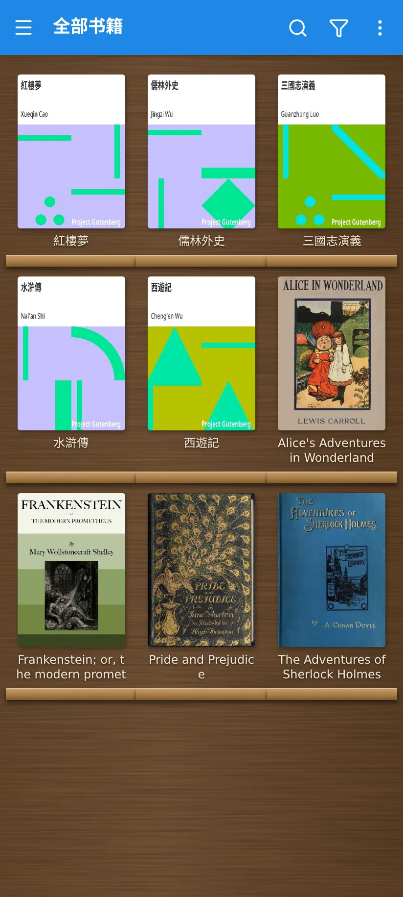
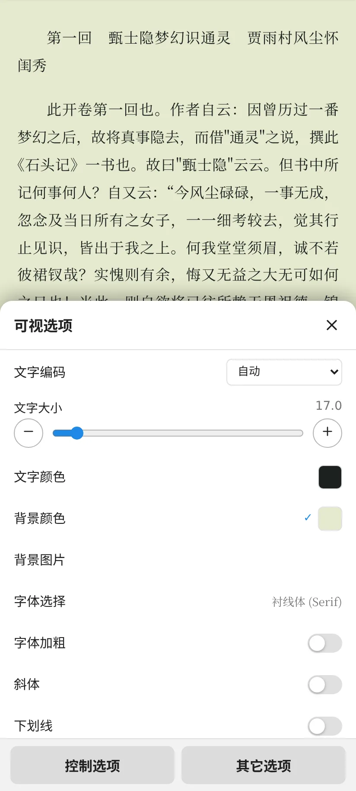
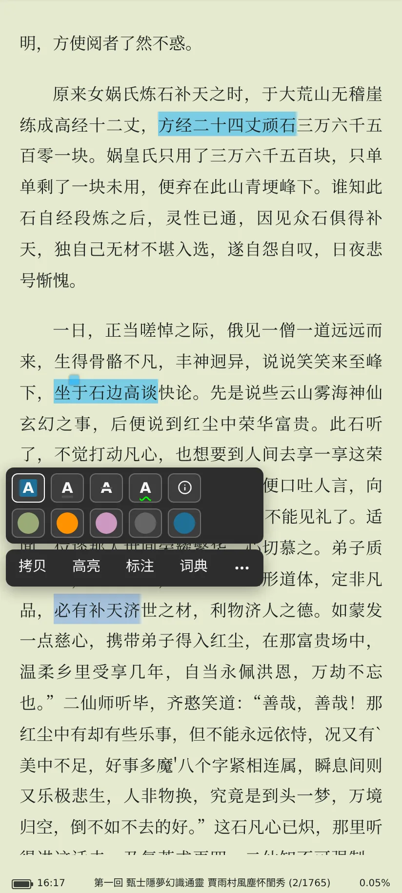
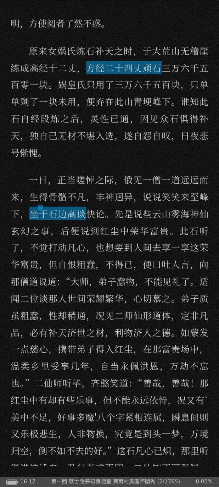
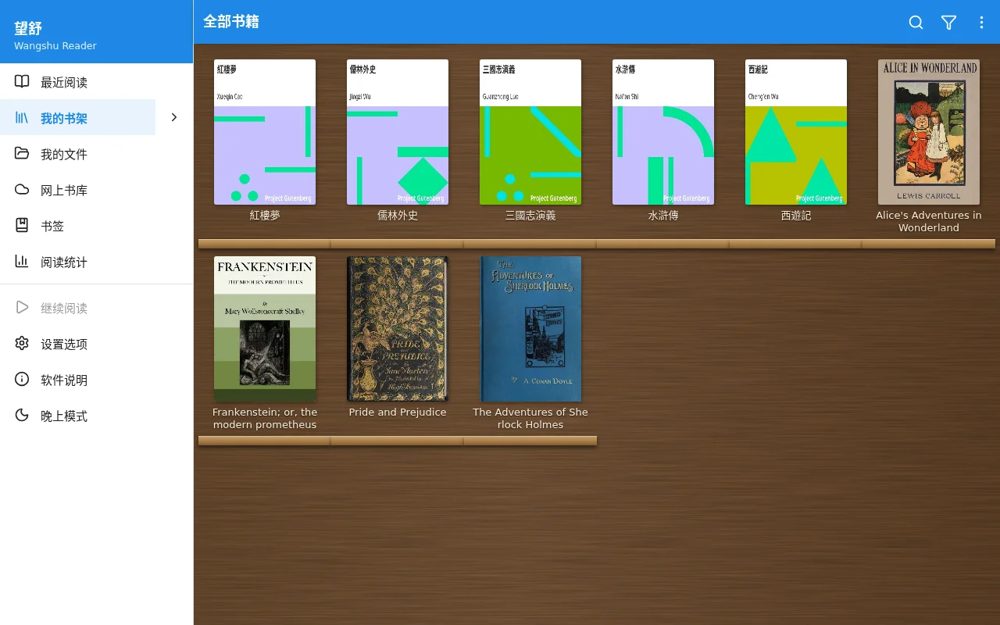

# 望舒 Wangshu Reader

[](https://github.com/noir017/wangshu-reader/actions/workflows/ci.yml)
[](LICENSE)

在浏览器里看电子书的阅读器。整个前端能打包成一个 html 文件，双击就能离线用；另外配了一个可选的 Node 服务端，用来做浏览器自己做不到的事，比如跨域访问网络书库、转换格式、WebDAV 同步、在线朗读。

界面与功能参考 Moon+ Reader（静读天下）。

## 截图

| 书架 | 阅读 | 可视选项 |
| :---: | :---: | :---: |
|  |  |  |
| **选字、高亮、笔记** | **夜间** | **网络书库（OPDS）** |
|  |  |  |



截图里的书都是 Project Gutenberg 的公版书，中文那本是《紅樓夢》，开着繁简转换。

## 能做什么

- **格式**：EPUB、TXT、PDF、MOBI / AZW / AZW3、FB2、HTML、Markdown、DOCX、ODT、RTF、UMD、CBZ 漫画；接上服务端后还能打开 CHM、DJVU、CBR，以及 RAR / 7z 压缩包里的书。TXT 会自动识别 GBK、Big5 等编码并切分章节。
- **阅读**：字体、行距、缩进、主题、背景纹理，多种翻页动画（含仿真翻页），单双页，自动滚屏，点击区与手势自定义，简繁转换，PDF 文本重排，漫画右到左。
- **标注**：高亮、下划线、笔记、书签，书内搜索，朗读（浏览器自带语音或服务端在线语音），查词与翻译，导出笔记。
- **书架**：分类、系列、标签、收藏，封面搜索，阅读统计，备份与恢复；能导入静读天下手机版的整库备份（`.mrpro`）。
- **同步**：通过 WebDAV 在多台设备间同步进度、标注、最近阅读和书籍文件；服务端自带一个 WebDAV。
- **网络书库**：OPDS（Gutenberg、Calibre 等），以及浏览服务端上的书库目录。
- 界面有中文和英文。

## 下载

不想自己构建，可以直接拿构建好的文件：

- **Release**：[最新版](https://github.com/noir017/wangshu-reader/releases/latest)，每个 `v*` tag 自动发布，附四个文件（文件名末尾是版本号，如 `-v0.1.2`）：
  - `wangshu-reader-single-<版本>.html`：单文件版
  - `wangshu-reader-web-<版本>.zip`：静态网站
  - `wangshu-reader-server-<版本>.zip`：服务端部署包（含前端）
  - `wangshu-reader-android-<版本>.apk`：Android app（arm64，自带服务端）
- **CI 产物**：main 上每次提交都会构建，在 [Actions](https://github.com/noir017/wangshu-reader/actions/workflows/ci.yml) 里点开某次运行，底部 Artifacts 里有前三样和一个 debug 签名的 APK（下载要登录 GitHub，默认保留 90 天）。debug 包和 Release 的包签名不同，不能互相覆盖安装。

## 四种用法

### 1. 单文件版

```bash
npm install
npm run build:single      # 产物：dist-single/index.html
```

把 `dist-single/index.html`（或 Release 里的 `wangshu-reader-single-<版本>.html`）拷到任何地方双击打开即可，书和设置都存在浏览器本地（IndexedDB）。需要服务端功能时，在「设置」里填服务端地址。

### 2. 静态网站

```bash
npm run build             # 产物：dist/
```

把 `dist/`（或解压后的 `wangshu-reader-web-<版本>.zip`）放到任意静态服务器上。

### 3. 带服务端

用 Release 里的部署包：

```bash
unzip wangshu-reader-server-v*.zip && cd wangshu-reader-server
npm ci --omit=dev
MR_HOST=0.0.0.0 MR_TOKEN=换成一个长随机串 MR_LIBRARY_DIR=/path/to/books npm start
```

或者从源码构建：

```bash
npm install
npm run build && npm run build:server
MR_HOST=0.0.0.0 MR_TOKEN=换成一个长随机串 MR_LIBRARY_DIR=/path/to/books npm start
```

浏览器打开 `http://<主机>:8090`。服务端会同时托管前端，前端自动连上它。需要 Node 22 及以上。

可选的系统依赖，缺了对应功能会自动置灰：`7zip`（压缩包、CHM）、`djvulibre-bin`（DJVU）、`espeak-ng`（离线朗读后备）。全部环境变量见 [server/README.md](server/README.md)。

⚠️ 服务端要给局域网或公网用时，一定要设 `MR_TOKEN`，否则书库读写和 WebDAV 对所有人开放。

另外，装成桌面应用（PWA）、关联本地文件夹自动导入这些功能，浏览器只在 https 或 localhost 下才给用。

### 4. Android app

```bash
npm install
android/scripts/build.sh  # 产物：android/app/build/outputs/apk/debug/app-debug.apk
```

app 自带服务端（本机模式），也可以改连远程服务端，详见 [android/README.md](android/README.md)。

## 开发

```bash
npm run dev           # 前端，vite
npm run dev:server    # 服务端，默认 127.0.0.1:8090
npm run typecheck
npm test              # 单元测试（vitest）
npm run e2e           # 端到端测试（playwright）
```

端到端测试和部分单元测试要用样书（`samples/`，不在仓库里）：先 `tests/samples/fetch.sh` 下载、`python3 tests/samples/gen.py` 生成；阅读器那部分还得先起 vite dev（`npx vite --host 127.0.0.1 --port 4173`）。完整步骤见 CI 的 e2e job —— CI 跑类型检查、单元测试、三种构建、Android 包和端到端测试。

技术栈：React 19 + TypeScript + Vite + zustand，服务端用 Hono。模块划分见 [docs/ARCHITECTURE.md](docs/ARCHITECTURE.md)。

## 许可证

[AGPL-3.0](LICENSE)。MOBI 解析用了 [foliate-js](https://github.com/johnfactotum/foliate-js)（MIT），许可证保留在 `src/formats/vendor/foliate-mobi/`。
